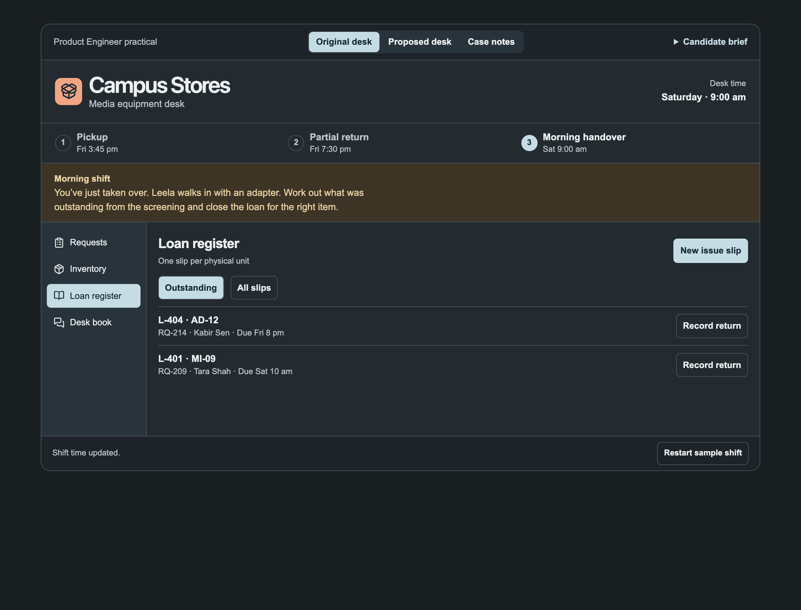
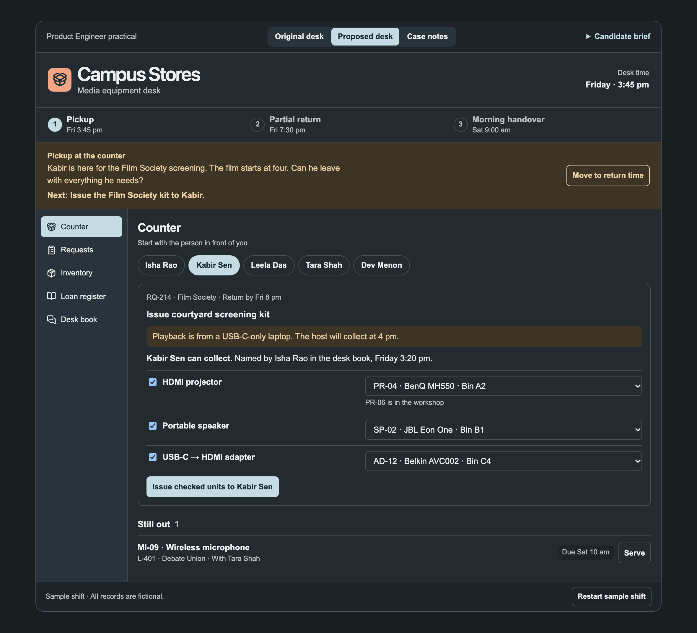
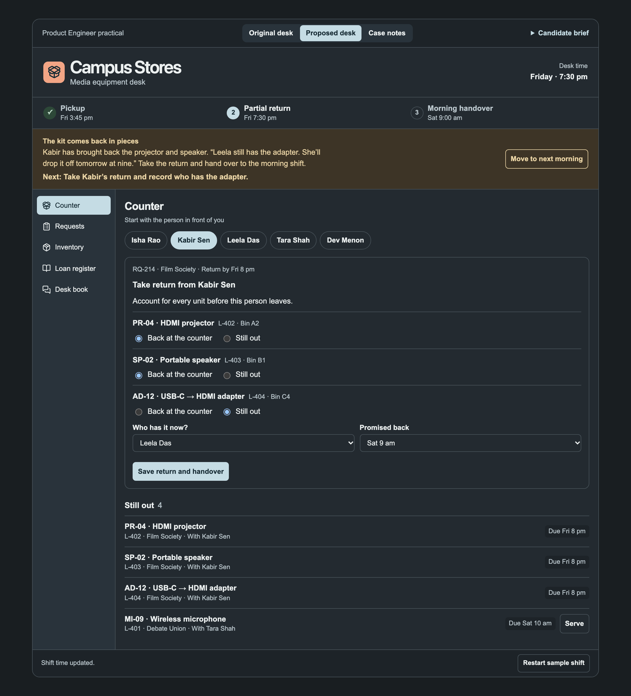
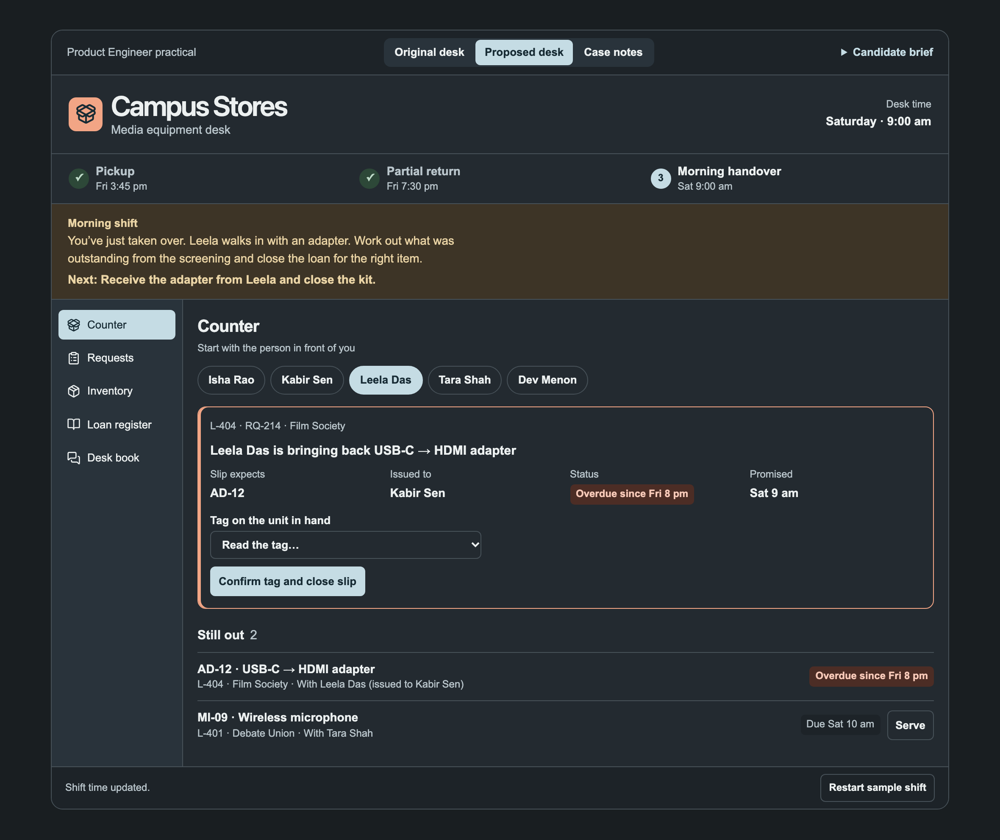

# Campus Stores

Campus Stores is a Product Engineer work sample set at a fictional campus media equipment desk. Work through a club’s screening, from equipment pickup to a partial return and the next morning’s handover. Open **Candidate brief** in the app for the assignment.

## My submission

**Decision: keep the product, and put the handover on the slip.** The desk tracks physical units well, but when a unit changes hands away from the counter, the loan record keeps naming the wrong person. I prototyped one change: custody travels with the unit.

Open the app and use the switch at the top:

- **Original desk** is the exercise as supplied, kept as the baseline.
- **Proposed desk** is the prototype.
- **Case notes** is the short version of this write-up.

### One moment the product handles well

While issuing the Film Society kit, the repair unit PR-06 is not offered. With AD-12 already out on RQ-214, adding AD-15 is refused because the approved quantity is on loan. Adding a digital camera is refused because the request does not include one. These checks stop bad pickups at the moment they would happen.

### One moment I would change

On Saturday morning Leela walks in with an adapter. Slip L-404 still says Kabir Sen, shows no overdue state, and sits beside Tara's microphone with the same one-click **Record return** button. Kabir's desk book message names Leela but not the unit, so the morning shift has to join two screens by hand. Nothing prompts a check of the tag on the adapter.



### The same job on the proposed desk

1. **Friday 3:45 pm, pickup.** Choose Kabir. The counter shows why Kabir may collect, surfaces the USB-C note, and prefills one kit form with units on the shelf.
2. **Friday 7:30 pm, partial return.** Mark each unit as back or still out. **Still out** requires who has it and when it is promised. The desk book entry is written from that record.
3. **Saturday 9:00 am, close.** Choose Leela. The card shows slip L-404, the overdue state, and the expected tag. The slip closes only when the tag in hand matches, and a wrong tag leaves it open with an explanation.

| Pickup | Partial return | Morning close |
| --- | --- | --- |
|  |  |  |

Counted clicks, selections and text entries from a scripted run of the full job:

| Moment | Original | Proposed | Trade-off |
| --- | ---: | ---: | --- |
| Pickup | 19 | 2 | Three slips become one reviewed kit form |
| Partial return | 5 | 7 | Deliberately slower, because custody becomes required |
| Morning close | 2 | 3 | One extra step buys a tag check |

### What I would keep

One slip per physical unit, the approval and quantity checks, the desk book for anything a form cannot hold, and Inventory and the Loan register as reference views.

### What I left out

Barcode scanning, borrower notifications, and staff accounts. Each is a larger bet, and none is needed to test whether custody on the slip helps.

### One observation at a real counter

Watch the first morning handover after a partial return. When the borrower's friend arrives, does the incoming staff member reach the right slip and read the physical tag **without opening the desk book or asking anyone**?

## Run the app

Open `index.html` in a modern browser. The app includes its scripts, styles, and icons and can run offline.

To serve it over local HTTP, run this from the repository folder and visit `http://localhost:8000`.

```sh
python3 -m http.server 8000 --bind 127.0.0.1
```

Each browser stores its own sample shift locally when browser storage is available. The original and proposed desks keep separate records, and **Restart sample shift** restores the fictional starting records for the desk you are viewing.

## Source

- `index.html` contains the desk layout, candidate brief, and bundled icons.
- `app.js` contains the sample records and interactions.
- `styles.css` defines the desktop and mobile layouts.

Icon license notices are in [third-party/lucide-LICENSE.txt](third-party/lucide-LICENSE.txt).


## Submit your work

1. [Fork Campus Stores](https://github.com/virinchi-healthcare/campus-stores/fork) into your GitHub account. Complete the candidate brief and push your changes to your public fork. In your README, point reviewers to your work and explain the decision you made.
2. In your fork, open **Commits**, select the final commit you want reviewed, and copy the page URL. It should look like `https://github.com/YOUR-USERNAME/campus-stores/commit/COMMIT-SHA`.
3. [Submit your work through the Google Form](https://docs.google.com/forms/d/e/1FAIpQLScvzoh1R4WS-SkiwAVBQbMvniieJYSoOEfLMyVo5CyjOvYUgQ/viewform). Your **roll number**, **email ID**, and **final commit link from your public fork** are required. Enter your roll number and email ID in the form only.
